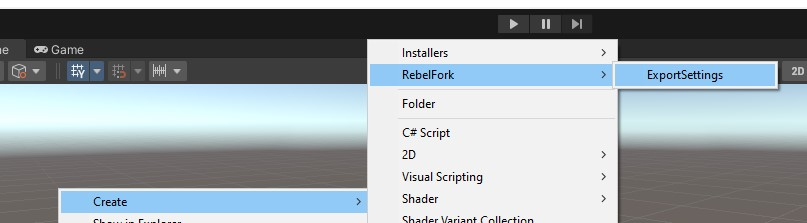
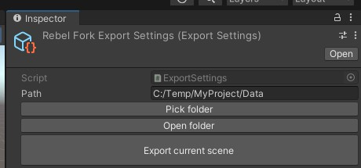

# Unity To RebelFork

## Is it legal?

Here is something you should read or watch on YouTube before proceeding:

## Dependencies

The project has LightInject as a embedded dependency.

## Installation

The main exporter package name is io.rebelfork.unityexporter. You can find it in Releases section of this github project.

Use [Package Manger](https://docs.unity3d.com/Manual/upm-ui.html) to add this package to your Unity project.

## Setup

First you need to create ExportSettings in the assets of your project. This asset going to hold all export settings for the project.

When selecting the asset you'll see the following in the Inspector window:

Path defines path to the Data folder of your project. You can use "Pick folder" button to select it from popup dialog window. "Open folder" will reveal the folder in Explorer/Finder.

"Export current scene" button starts the export of the current scene and all related assets into target folder.
## Rooms and portals (Toe target)

For the Toe engine's portal culling, add **Visibility Room**, **Visibility Room Box** and **Visibility Portal** components (menu `GameObject/Toe/...`). With the export target set to Toe they become `VisibilityRoom` and `Portal` components (a portal also gets a stable id); the Rbfx target leaves them out with one warning per scene. A room is a box (or several, using Visibility Room Box on child objects) and a priority; a portal is a rectangle in the XY plane that looks along +Z, and the two rooms it joins are found from the geometry, not assigned. The scene view draws rooms and portals (a portal whose two sides are the same room, or none, is red). Rooms must be closed (walls, floor, roof). The export warns about rooms of the same priority and size that overlap, a portal with no room on either side or the same room on both, and a room with no box of any size. See the Toe guide `unity-export`, section "Rooms and portals".

## Jiggle bones (Toe target)

For the Toe engine's secondary motion (Toe.JiggleBones: skirts, hair, tails, breasts), put **Jiggle Chain** components on the root bones of the chains and **Jiggle Collider** components on the bones of the body that the chains must not enter (menu `GameObject/Toe/...`, or select a bone and use the menu). A chain is its bone and the bones below it that follow it one by one (a bone with several children ends the chain, with a warning); its numbers are the stiffness, damping, gravity, thickness (`radius`), the largest turn away from the animation (`maxAngle`) and, for the tail after the last bone, `tailLength` and `tailDirection` (Extend, Down, AwayFromParent). A collider is a sphere or capsule in the space of its bone; the scale of the bone is baked in at export. The components are no Unity physics: the gizmos draw them. `Tools/Toe/Jiggle/Add to selected character` adds chains by the start of the bone names (`skirt_`, `breast_`, `harir_`, `hair_`) and fits colliders to the humanoid bones from the skinned mesh. Put them on a prefab (a variant of the model's prefab) so that they are kept.

With the export target set to Toe, the character export (`-exportCharacter`) writes them as the `jiggle` section of `Characters/<name>.json`, which the engine reads (`JiggleConfigResource`, `JiggleAnimator.Create`); the Rbfx target leaves them out with one warning. See the Toe guide `unity-export`, section "Jiggle bones", and the tool `jiggle info <name>`.

## Cloth (Toe target, Magica Cloth 2)

With the export target set to Toe, the **Magica Cloth 2** components of a character prefab are written as the `cloth` section of `Characters/<name>.json` (character export), which the Toe engine's Toe.Cloth reads. The exporter does not depend on Magica Cloth 2: it finds `MagicaCloth2.MagicaCloth` and the collider components by the name of their type and reads their members by reflection. Bone Cloth is exported (the root bones in the order they were registered, the connection mode, all the parameters with their curves sampled at 16 points along the depth, the colliders in the space of their bone with its scale baked in); a Mesh Cloth is left out with a warning. The Rbfx target leaves cloth out with one warning. See the Toe guide `unity-export`, section "Cloth", and the tool `cloth info <name>`.

Baked humanoid clips (`-exportClips`, `HumanoidClipBaker`) are written in the space of the skinned mesh that lies nearest to the rig's origin, not of the first one found: a character made of parts can have a part whose object is placed away from the others (the blouse of the Vampire Girl is 1.07 m below the origin), and a clip written in that part's space would carry its offset (the character floats). The placement of the root at the first frame is not baked either: the top-level bones start at the bind pose and keep only the motion after it.
