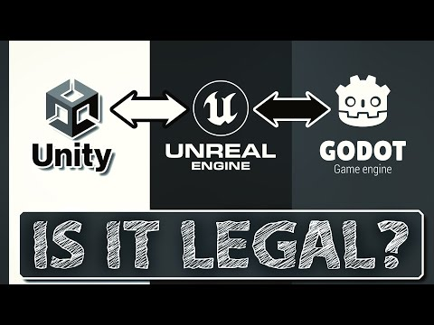

# Unity To RebelFork

This is an experimental (work in progress) tool to convert Unity3D assets to a format that RebelFramework can read.

Exporting assets from Unity to other game engines is a common practice among game developers. This is because Unity provides a wide range of tools and features that make it easy to create high-quality assets. However, Unity may not be the best engine for every game development project. For example, some developers may prefer RebelFork for its open-source nature and ease of use.

Here is something you should read or watch on YouTube before proceeding:

# Documentation

[Documentation](Documentation~/README.md)
# Export targets

The exporter writes for one engine, chosen by `ExportSettings.Target`:

- **Rbfx** (default): plain rbfx content. Menu `Tools/RebelFork/Export assets`, or batch `-executeMethod UnityToRebelFork.Editor.BatchExport.RunRbfx`.
- **Toe**: additionally writes files only the Toe engine reads (`<model>.humanoid.json`, `humanBones` in `Characters/<name>.json`, `Effects/<name>.json`)
  and can normalize the baked humanoid clips with the toe CLI. Menu `Tools/Toe/Export assets`, or batch `BatchExport.RunToe`.

Batch arguments: `-exportTarget rbfx|toe` (for `BatchExport.Run`), `-normalize` and `-toe <path of toe.dll>` (Toe target only).

# Sprites and audio (Toe target)

`-exportSprites <list file>` and `-exportAudio <list file>` (batch, `RunToe`), or selecting the assets and `Tools/Toe/Export assets`:

- A texture imported as sprites (Single or Multiple) becomes `<path>.png` (the source PNG itself) and `<path>.json`, a sprite sheet with the rectangle (from the **top**-left,
  Unity counts from the bottom), pivot and pixels per unit of every sprite, and `pixelArt` when the texture is point filtered.
- A prefab with an Animator and sprite renderers becomes `<path>.anim.json`, an animation set: one clip per Animator state that plays a sprite animation (frames, rate, loop,
  events) and a `states` map from the lowercase state name to the clip. Clips key the sprite with an object reference curve on `SpriteRenderer.sprite`, or with the
  `SpriteResolver` of the 2D Animation package (the key is the hash of `Category_Label` in the prefab's Sprite Library, read by reflection: the package is not needed to compile
  the exporter). The key at the very end of a clip that only wraps a loop is dropped; the last pose of a clip that does not loop is kept.
- An audio clip is exported from its source file; with `-toe <toe.dll>` and ffmpeg on the PATH it is encoded to Ogg Vorbis (`toe sound encode`) and the original is removed
  (setting *Encode Audio*). Unity cannot write Ogg itself.
- A list file has one asset path or folder per line (`#` comments). A folder offers everything in it to the exporters; assets that are no sprites or audio are skipped.
  A line can end with `| ppu=32` to force pixels per unit on the sprites under it (a pack is drawn for its own unit, a game has one).
- The three exporters are registered as `0SpriteSheetExporter`, `0SpriteAnimationExporter` and `0AudioClipExporter`: the orchestrator asks exporters in the order of their
  names and takes the first that accepts an asset, and `TextureExporter` and `AnimationExporter` accept everything, so the `0` puts the sprite exporters first. A batch run takes
  sprites and audio only when asked for them (`ExportContext.ClaimSpriteAssets`), so exporting characters does not change.
- Tilemaps are not exported: a tile sheet is a sprite sheet. The pure parts (hash, sheet and animation JSON, keys to frames) have no Unity dependency and run as plain NUnit
  tests (`Tests/Editor/SpriteExportTests.cs`).

# Reflection probes

A scene export writes each Unity `ReflectionProbe` as a `ReflectionProbe` component (plus a `ReflectionProbeManager` on the scene) and puts the
scene's default reflection on the zone. The cube maps are exported as HDR: `<name>.dds` (RGBA16F, DX10 header, full mip chain) and `<name>.xml`
(`<cubemap>` with the image and an `<sh>` tag for the ambient light). Probes with Toe's attributes (`Mode`, `Intensity`, `Blend Distance`, ...) are
read by Toe; rbfx skips what it does not know. Cube maps used by materials are not exported.

Mip levels: for the **Rbfx** target Unity's own (roughness-blurred) mips are written as they are, because rbfx reflects with a probe texture's mips without
filtering them. For the **Toe** target the file has level 0 plus averaged mips and Toe makes the roughness chain itself when a game first uses the cube map;
a batch export with `-toe <path of toe.dll>` (setting `PrefilterCubemaps`, default on) has the Toe CLI bake that chain into the files instead
(`cubemap prefilter <xml>... --in-place`), so nothing is filtered at load.

# Shader Graph materials

A material whose shader is a Shader Graph is no longer mapped by guessing property names. `Editor/Material/ShaderGraph` reads the `.shadergraph` (and its Sub Graphs)
and **evaluates it with the material's own values**: each texture in turn is replaced, channel by channel, by 0 and 1 (otherwise it is its average colour) and the change of
the master outputs says what the texture does. From that the exporter finds, whatever the properties are called:

- the **albedo**: the texture whose red, green and blue move BaseColor one to one (a layer the material switches off, a mask, a second layer at strength 0 do not); the
  colour it is multiplied by (tints, contrast, saturation, lerps at the material's strength) becomes `MatDiffColor`. A graph that inverts the texture gets it remapped;
- the **normal map** (the texture that moves NormalTS) and `NormalScale`;
- **roughness, metallic and occlusion**: the channel of a texture that moves Smoothness, Metallic and Occlusion most, packed into the `Properties` texture
  (R roughness, G metallic, A occlusion) with the range the graph maps it to; constants when no texture moves them;
- the **emission**, the **alpha** (the albedo's alpha, or a separate opacity mask packed into the albedo's alpha) with `ALPHAMASK` / cutoff when the material clips, and the
  **tiling** (`UOffset` / `VOffset`, from the coordinates the albedo is sampled at).

The summary of every material is logged (`[ShaderGraph] material '...'`) with the influence of each texture, so a wrong guess is easy to see. A graph the reader does not
understand (the old pre-2020.2 format, an error) goes to `DefaultShaderMapping`; nodes the interpreter does not know give the average of their inputs and a warning, nodes that
depend on the world (time, position, noise) give fixed values. Not done: unlit graphs are exported as lit materials; curves in a mask (a threshold, a smoothstep) are fitted by a
straight line between the mask's 0 and 1; a texture used by several outputs in ways the exporter cannot share (one coordinate transform per material) uses the albedo's.

The reader (`ShaderGraphDocument`), interpreter (`ShaderGraphEvaluator`) and analyser (`ShaderGraphAnalyzer`) use no Unity types and are tested as plain NUnit tests
(`Tests/Editor/ShaderGraphAnalyzerTests.cs`). The package does not depend on `com.unity.shadergraph`: the file format is read directly with Newtonsoft (which the package already
needs), so it does not change with the Shader Graph version and projects without Shader Graph do not pull it in.

# Terrains

A scene or prefab export writes each Unity `Terrain` as a child node (at the terrain's centre: rbfx centres a terrain on its node, Unity starts at the corner) with an
rbfx `Terrain` component. Next to the asset of its `TerrainData` it writes:

- `<name>_height.png`: the height map, 16 bits as red (high byte) and green (low byte) of an RGB picture, the first row the north edge. The component's `Vertex Spacing`
  is `size / (heightmapResolution - 1)` across and `size.y * 256 / 65535` high, `Patch Size` is 32 (the whole terrain when smaller).
- `<name>_weights.png`: the weights of the three most used layers (normalised) as red, green and blue. A layer's use is its weight added up over the terrain; with more than
  three layers the three that paint most are taken, most used first, and the log says which (`layers 3, 4, 0, painting 93.8 % of the terrain`). A pixel painted only with
  the other layers shows the most used one. A terrain with three layers or fewer keeps them in their own order.
- `<name>.material`: the blend material (`Techniques/TerrainBlend.xml`: the weights in the albedo slot, the layers' diffuse textures in the normal, properties and
  emission slots, `DetailTiling` = terrain size / the first layer's tile size).

Unity places a terrain by its world position only (its object's rotation and scale, and those of its parents, are ignored), so the terrain's node cancels the rotation and
scale of its parents and drops its own: the centre offset is then in world axes. The `TerrainCollider`'s shape and its static `RigidBody` are written on that child node, because
the engine's terrain shape reads the height field of the `Terrain` component on its own node.

Not exported (each logs a warning): layers beyond the three most used, exported layers with different tile sizes, holes, tree instances, grass and detail meshes. A `TerrainCollider` only
adds a collision shape of type Terrain, which Toe has no shape for. The numbers are worked out by `Editor/Terrain/TerrainConverter.cs`, which does not use Unity.
