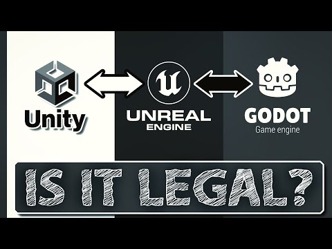

# Unity To RebelFork

This is an experimental (work in progress) tool to convert Unity3D assets to a format that RebelFramework can read.

Exporting assets from Unity to other game engines is a common practice among game developers. This is because Unity provides a wide range of tools and features that make it easy to create high-quality assets. However, Unity may not be the best engine for every game development project. For example, some developers may prefer RebelFork for its open-source nature and ease of use.

Here is something you should read or watch on YouTube before proceeding:

# Documentation

[Documentation](Documentation~/README.md)
# Export targets

The exporter writes for one engine, chosen by `ExportSettings.Target`:

- **Rbfx** (default): plain rbfx content. Menu `Tools/RebelFork/Export assets`, or batch `-executeMethod UnityToRebelFork.Editor.BatchExport.RunRbfx`.
- **Toe**: additionally writes files only the Toe engine reads (`<model>.humanoid.json`, `humanBones` in `Characters/<name>.json`, `Effects/<name>.json`)
  and can normalize the baked humanoid clips with the toe CLI. Menu `Tools/Toe/Export assets`, or batch `BatchExport.RunToe`.

Batch arguments: `-exportTarget rbfx|toe` (for `BatchExport.Run`), `-normalize` and `-toe <path of toe.dll>` (Toe target only).
